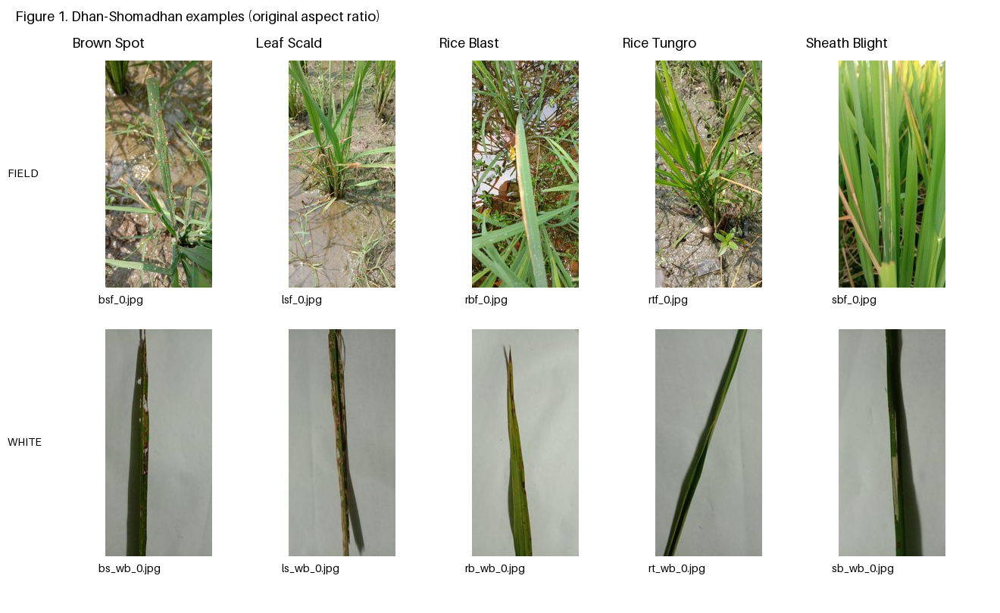

# CSCI435 group project: rice leaf disease classification

This repository holds the shared data preparation for our rice disease
classification project. It includes the image inventory, inspection figures,
review decisions, Python loader and five saved train/validation/test splits.
The original images are downloaded separately. Model training is the next step;
there are no trained models or classification results here yet.

Start with the setup steps below, then read the
[group handover](GROUP_HANDOVER.md). It explains the work for each method, the
files to return, how to compare results, and what the data can support in later
experiments.

## Get the dataset

1. Clone this repository and enter its directory:

   ```bash
   git clone https://github.com/jena-mari/435GROUPWORK.git
   cd 435GROUPWORK
   ```

2. Download **version 1** from the original
   [Mendeley Data record](https://data.mendeley.com/datasets/znsxdctwtt/1)
   (DOI: `10.17632/znsxdctwtt.1`). Use the record's **Download All** button.
   The archive is approximately 1.83 GiB; the 1,106 extracted image files occupy
   approximately 2.23 GB.

3. Extract the archive into the repository root, merging its `Dhan-Shomadhan`
   directory with the one already present. Preserve the source folder names and
   image filenames, including the spaces in background folder names. The expected
   layout is:

   ```text
   435GROUPWORK/
   ├── data_preprocessing/
   └── Dhan-Shomadhan/
       ├── Field Background  /    # two trailing spaces in the source name
       ├── White Background /    # one trailing space in the source name
       ├── Dhan-Shomadhan_picture_Information.csv
       └── preprocessing/        # already included in Git
   ```

   Avoid introducing a second nested `Dhan-Shomadhan/Dhan-Shomadhan` directory.
   The committed manifests preserve the original paths. If your extraction tool
   strips trailing spaces, use an environment that preserves the source paths
   (for example macOS, Linux or a Linux filesystem inside WSL).

4. Verify the downloaded images against the audited SHA-256 inventory:

   ```bash
   python data_preprocessing/verify_dataset.py
   ```

   This check uses only Python's standard library. It verifies every expected
   image's exact bytes, the source metadata and all 15 saved manifest checksums.
   It exits unsuccessfully if files are missing or different. All group members
   should verify the same dataset before training.

## Install and test the preprocessing code

Use Python 3.12:

```bash
python -m venv .venv
source .venv/bin/activate
python -m pip install -r data_preprocessing/requirements.txt
python -m unittest discover -s data_preprocessing -p 'test_prepare_dataset.py' -v
```

On Windows, activate the environment with `.venv\Scripts\activate`.
Model training additionally needs the team's chosen PyTorch/torchvision environment.

## Use the shared splits

The current version is recorded in
[`CURRENT_SPLIT_VERSION.txt`](Dhan-Shomadhan/preprocessing/CURRENT_SPLIT_VERSION.txt).
It contains one directory for each seed: **11, 22, 33, 44, 55**, with `train.csv`,
`validation.csv` and `test.csv` files. These are repeated random holdouts targeting
70/15/15, not five-fold cross-validation. All three methods must use the same
saved version.

```python
from pathlib import Path
from data_preprocessing.prepare_dataset import RiceDataset

root = Path('Dhan-Shomadhan')
audit = root / 'preprocessing'
version = audit / (audit / 'CURRENT_SPLIT_VERSION.txt').read_text().strip()
training = RiceDataset(root, version / 'seed_11/train.csv')
sample = training[0]
# sample: image (RGB PIL), disease_id, background_id, image_id
```

Supply model-specific transforms through the loader's `transform=` argument.
For a PyTorch batch, use a transform returning fixed-size tensors. Apply random
augmentation only to training images; fit any learned preprocessing only on the
corresponding training partition. Background is evaluation metadata.

## Audit findings and grouping policy

| Disease | Field | White | Total |
|---|---:|---:|---:|
| Brown Spot | 49 | 90 | 139 |
| Leaf Scald | 74 | 143 | 217 |
| Rice Blast | 74 | 198 | 272 |
| Rice Tungro | 76 | 119 | 195 |
| Sheath Blight | 64 | 219 | 283 |
| **Total** | **337** | **769** | **1,106** |

All images passed decoding. No byte-identical duplicate groups or disagreements
between supplied metadata and mapped folder labels were found. Folder/CSV
agreement does not independently establish correct biological labels.

The selected policy keeps unresolved perceptual-similarity candidates together.
There are 1,394 candidate pairs: four visually supported related pairs and 1,390
unresolved pairs conservatively grouped. All 1,106 images are retained in 613
groups. This reduces leakage risk through candidate relationships without claiming
that every candidate is the same leaf. False grouping and missed relationships
remain possible. The largest group has **461 white-background images** and is
assigned to training in every run, which limits test coverage.



## Inspect the reports

- [Problem Description, preparation approach and algorithm](Dhan-Shomadhan/preprocessing/report_sections.txt)
- [Raw disease/background counts](Dhan-Shomadhan/preprocessing/counts_raw.csv)
- [Verification record](Dhan-Shomadhan/preprocessing/VERIFICATION.txt)
- [Detailed usage instructions](data_preprocessing/README.txt)

Open `Dhan-Shomadhan/preprocessing/dataset_report.html` in a local browser for the
formatted report, or `review.html` and `gallery_*.html` to inspect the previews.
GitHub displays HTML source rather than rendering these reports as a website.

## Reproduce the preparation

The committed outputs are ready to use; do not regenerate a different split for
each model. For an independent rerun, download and verify the source data first,
then run an audit into a new directory so the saved audit and reviews are preserved:

```bash
python data_preprocessing/prepare_dataset.py audit --output Dhan-Shomadhan/preprocessing_rerun
python data_preprocessing/prepare_dataset.py build --output Dhan-Shomadhan/preprocessing_rerun --conservative-pending
```

All initial candidate edges are grouped by this policy, so the four recorded
visual confirmations do not change group allocation relative to retaining every
candidate conservatively. Preserve the committed review files to reproduce their
full decision history and provenance. The generator prints the saved version path.
Adopt a replacement version only when the whole team agrees, then update the
current-version pointer explicitly.

The `.gitignore` rules also exclude new generated directories under the dataset
by default. Explicitly add a new audit directory only when the team intends to
share it. Keep submission archives consistent with the assignment's requirements;
the GitHub repository is the collaboration workspace.

## Dataset attribution

The original dataset and its preview derivatives are attributed to Md Fahad
Hossain, Sheikh Abujar, Sheak Rashed Haider Noori and Syed Akhter Hossain (2021),
“Dhan-Shomadhan: A Dataset of Rice Leaf Disease Classification for Bangladeshi
Local Rice,” Mendeley Data, V1, DOI: `10.17632/znsxdctwtt.1`.
The dataset record identifies the licence as
[Creative Commons Attribution 4.0 International](https://creativecommons.org/licenses/by/4.0/).
Preview figures resize images and add labels/layout; original source images are
not included in this repository. No project-wide software licence is assigned here.
