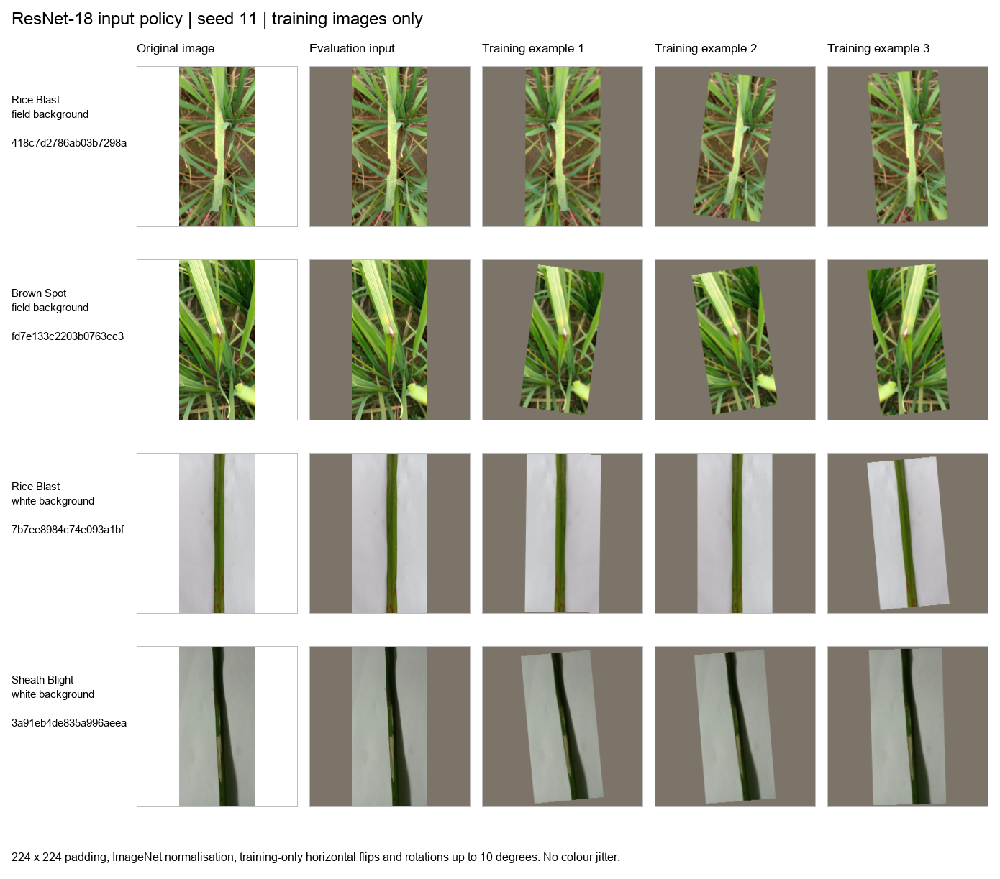

# Shared CNN components handover

The supplied `SharedCNNComponents` package has been reconciled with the current
`resnet18/` implementation. Both CNN variants use one active `common.py`, the
same approved image policy and the same versioned manifests. The frozen
experiment remains in `train_frozen.py`; the matching fine-tuned driver is
`train_finetuned.py`.

## Commands for group members

Run from the repository root after activating `.venv-cnn`. Substitute the folder
containing the original images for `/path/to/Dhan-Shomadhan`. The shared audit
defaults to the repository's `Dhan-Shomadhan/preprocessing/` directory.

```bash
python -m resnet18.check_cnn download-weights --dataset /path/to/Dhan-Shomadhan
python -m resnet18.check_cnn preview --dataset /path/to/Dhan-Shomadhan
python -m resnet18.check_cnn check --dataset /path/to/Dhan-Shomadhan
python -m resnet18.check_cnn smoke --dataset /path/to/Dhan-Shomadhan
python -m unittest discover -s resnet18/tests -v
```

| Command | What it does | Default output under the dataset |
|---|---|---|
| `download-weights` | Downloads or verifies the official ImageNet ResNet-18 weights through the existing shared loader | `model_cache/torchvision/resnet18-f37072fd.pth` |
| `preview` | Shows original training images, deterministic evaluation inputs and three training augmentations for each selected image | `experiments/resnet18_checks/transform_preview_seed_11/` |
| `check` | Verifies original image hashes and all 15 manifests, checks all five split allocations, then runs a small frozen and fine-tuned check | `experiments/resnet18_checks/shared_check/seed_11/` |
| `smoke` | Runs the integrated frozen driver on ten training and ten validation images | `experiments/resnet18_checks/shared_smoke/seed_11/` |

All diagnostics use training/validation images only. `check` reads test manifest
metadata to verify membership and separation; it does not evaluate test images.
By default, the training checks use batch size 4 and one epoch. Use `--epochs`
1–3 and `--batch-size` for these small checks. `--seed` selects one of the five
saved partitions; `--device cpu` (or `--cpu`) forces CPU. The two-stage check
keeps image-loading workers at zero; the frozen smoke command accepts `--workers`.

Each check/preview needs a fresh `--output` directory under the dataset. For
`smoke`, the driver adds `seed_<seed>/` below that directory. Existing outputs
are preserved. Test predictions and full experiment results are not generated
by these commands.

## Preview figure



*Original training images alongside the evaluation input and three examples of
training augmentation. Images retain their aspect ratio through padding to
224 x 224. Fixed ImageNet normalisation is reversed for display. The figure
illustrates the implemented policy; it does not show model predictions.*

The preview uses two diseases from each background by default. `--per-background`
can select 1–5. Its JSON sidecar records the selected training IDs, original paths,
seed, manifest context, complete policy and source hashes. Generating a preview
does not change a caller's CPU augmentation random state. The shared example
above is accompanied by [its metadata](validation_reports/transform_preview_seed11.metadata.json).

## API mapping for supplied code

Use [COMMON_COMPONENTS.md](COMMON_COMPONENTS.md) for the complete current API.
The following mapping helps group members adapt code written for the supplied
package. These names are not interchangeable aliases.

| Supplied API | Current implementation |
|---|---|
| `set_seed`, `get_device` | `seed_everything`, `choose_device` |
| `load_shared_splits`, `make_loader` | `make_shared_data`; use its `.datasets`, `.loaders` and `.context` |
| `TrainTransform`, `EvalTransform` | `image_transform(training=True/False, policy=ImagePolicy())` |
| `build_resnet18` | `build_model('frozen', cache_dir=...)`; fine-tuning uses `initialise_finetuned` |
| `set_trainable`, `count_parameters` | `configure_trainable`, `assert_model_contract`, `make_optimizer` |
| Custom `ResNet18.train()` | Call `prepare_training_mode`; the common `train_one_epoch` does this automatically |
| `BestTracker`, `save_checkpoint` | `BestCheckpoint.update`; strict validation macro-F1 improvement |
| `load_checkpoint` | Current `load_checkpoint` requires matching context and stage |
| `predict`, `write_predictions`, `check_predictions` | `evaluate` and selected-checkpoint `export_predictions` |
| `get_scores`, `summary_rows` | `score_predictions`, `summarise_runs`; five distinct seeds are required |
| `base_run_config` | `run_configuration`, extended by each experiment driver |

## Decisions retained during integration

The supplied `common.py` matches the alternative common implementation that
arrived with the frozen experiment. Its proposed 448 x 224 portrait input,
random crops, vertical flips, brightness/contrast changes and 15-degree rotations
differ from the policy already approved for the project. The active policy stays
224 x 224 padding, horizontal flips with probability 0.5 and rotations up to
10 degrees, with no colour jitter or random crop. Both CNN variants must match.

The current code retains torchvision's ResNet-18 architecture, verified ImageNet
weights and checkpoint guards for seed, manifest hashes, policy and stage.
Validation macro-F1 ties count as no improvement. The alternative loss-based
tie-breaker and weaker checkpoint identity checks have not been adopted.
The supplied `compare-resize` command is not part of the integrated CLI; changing
the approved input policy would require a separately documented experiment.

The [original package snapshot](reference/shared_cnn_components/README.md) keeps
all supplied files byte-for-byte as reference text, with a source manifest. It is
not a second importable implementation or a replacement requirements file.
The [validation record](validation_reports/shared_components_seed11_mps.json)
documents the integrated checks. Full five-run CNN outputs are in `../results/`.
